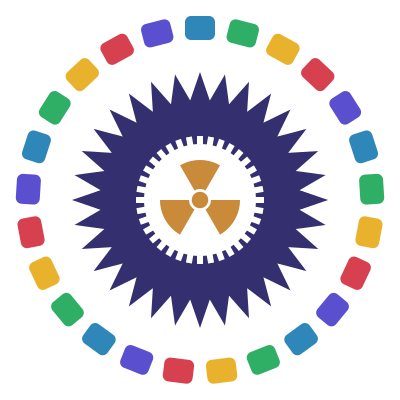

<p align="center"></p>

# Jeopardy Bioimágenes

Jeopardy académico para la **Celebración de la Jornada de Bioimágenes 2026** de la Licenciatura en Producción de Bioimágenes (Departamento de Ciencias de la Salud y Deporte, UNPAZ).

**Autor:** Mg. Lic. Prof. Leandro Guerschberg · 2026
Profesor Adjunto Seminario de Informática IQ/BIO · Universidad Nacional de José C. Paz

---

## Cómo se juega

- Compiten dos equipos por turnos. El equipo de turno elige una categoría y un valor del tablero.
- Cada pregunta tiene cuatro opciones y un tiempo límite.
  - Respuesta correcta: suma el valor de la pregunta.
  - Respuesta incorrecta: resta el valor.
  - Sin respuesta (tiempo agotado): no cambia el puntaje.
- Después de cada pregunta el turno pasa al otro equipo. Tocando el puntaje de un equipo se le puede dar el turno manualmente.
- **Daily Double:** casilleros ocultos en los que el equipo apuesta antes de ver la pregunta.
- **Final Jeopardy:** al completar el tablero, ambos equipos apuestan y responden la misma pregunta; quien conduce marca cada respuesta.
- Gana el equipo con mayor puntaje final.

La partida se guarda en el navegador: si se cierra la página, se puede continuar desde la pantalla de inicio.

### Niveles

| Fila | Valor | Nivel |
|---|---|---|
| 1 y 2 | 200 y 400 | Nivel 1 |
| 3 y 4 | 600 y 800 | Nivel 2 |
| 5 | 1000 | Nivel 3 |

### Categorías

Anatomía radiológica · Física de las radiaciones · Técnica y posicionamiento · Protección radiológica · Modalidades de imagen.

### Atajos de teclado

| Tecla | Acción |
|---|---|
| `1`–`4` o `A`–`D` | Elegir una opción |
| `H` | Mostrar la pista |
| `Enter` | Continuar |
| `F` | Pantalla completa |
| `S` | Activar o silenciar el sonido |

## Configuración

Desde **Configuración** (protegida con contraseña) se puede elegir el tiempo por pregunta, la cantidad de casilleros Daily Double, activar el Final Jeopardy y el avance automático, e importar o exportar el banco de preguntas.

## Preguntas

Las preguntas están en [`questions.json`](questions.json). Para modificarlas:

1. Abrir el **Editor de preguntas** (`json-creator.html`, también accesible desde Configuración).
2. Editar y elegir:
   - **Usar en este navegador:** el banco queda guardado solo en esa computadora.
   - **Descargar questions.json:** para publicarlo, reemplazar el archivo `questions.json` del repositorio en GitHub. Netlify actualiza el sitio en uno o dos minutos.

Formato de cada pregunta:

```json
{
  "value": 200,
  "level": 1,
  "prompt": "¿Cuántas vértebras cervicales tiene la columna vertebral humana?",
  "answer": "7",
  "options": ["7", "5", "12", "8"],
  "correctIndex": 0,
  "hint": "La primera es el atlas y la segunda el axis.",
  "image": ""
}
```

## Publicación

Es un sitio estático: no requiere compilación. En Netlify se publica la carpeta raíz del repositorio, sin comando de compilación.

## Estructura

```
index.html          Juego
json-creator.html   Editor de preguntas
questions.json      Banco de preguntas publicado
css/estilos.css     Estilos
js/jeopardy.js      Lógica del juego
js/sonidos.js       Efectos de sonido
img/                Logos
```
